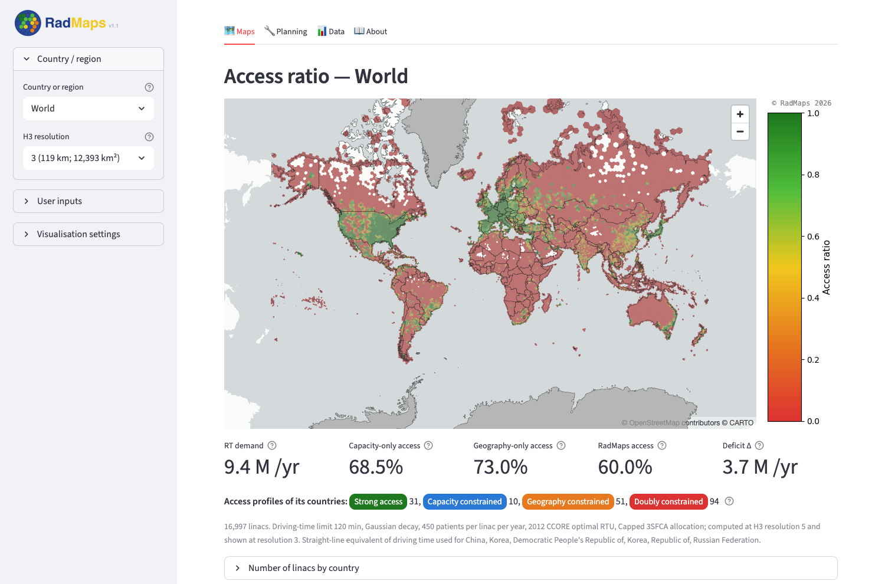
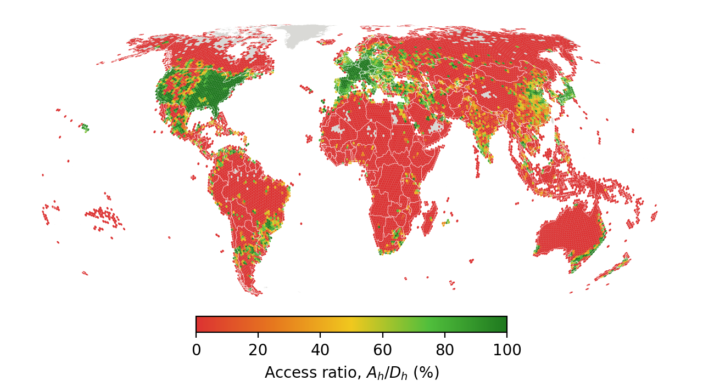

<p align="center">
  
</p>

<p align="center">
  <b>Simultaneously modelling capacity and geographic constraints on radiotherapy access</b>
</p>

<p align="center">
  <a href="https://arxiv.org/abs/2605.23456"></a>
  <a href="https://rtaccess.streamlit.app/"></a>
  <a href="LICENSE"></a>
  
</p>

RadMaps estimates, for every hexagon of Uber's [H3 grid](https://h3geo.org/), how many cancer patients
would benefit from radiotherapy each year and how many of them can actually be treated, given where the
radiotherapy machines are, how many patients each can treat, and how far patients would have to drive.
It combines high-resolution population data, national cancer incidence, the IAEA inventory of
radiotherapy centres and stored driving times, and works at any scale from a single country to the
whole world.

The method and the global results are described in the paper
([arXiv:2605.23456](https://arxiv.org/abs/2605.23456)); this repository contains the model, the
interactive dashboard (**RadMaps v1.1**) and the scripts that produce the paper's figures and tables.

<p align="center">
  
</p>

---

## What RadMaps computes

1. **Demand.** National GLOBOCAN 2024 incidence for each of 34 cancer categories is multiplied by its
   optimal radiotherapy utilisation rate (RTU; the 2012 CCORE model by default) and spread over the
   population of each hexagon (Kontur), giving the radiotherapy demand $D_h$ in patients per year.
2. **Geographic access.** A distance-decay function $P(x)$ of driving time $x$ (or straight-line distance)
   gives the probability that a patient can reach each centre: step, exponential, Gaussian or power law,
   each cut off at a maximum driving time.
3. **Allocation.** Each hexagon's accessible demand is shared between the centres it can reach, weighted
   by distance and centre size, and a centre asked to treat more patients than its capacity treats the
   same fraction of every share it receives (**capped 3SFCA**). A **nearest-first** rule is available as
   an alternative.
4. **Metrics.** Per hexagon and summed over countries or regions: patients treated $A$, access ratio
   $A/D$ and deficit $\Delta = D - A$, alongside the single-constraint benchmarks **capacity-only** access
   $A_\text{C}/D$ and **geography-only** access $A_\text{G}/D$.
5. **Access profiles.** Comparing the three metrics classifies each country as having strong access, or
   as capacity constrained, geography constrained or doubly constrained.

In the paper's main configuration (Gaussian decay, 2 h driving-time limit, 450 patients per linac per
year, H3 resolution 5) installed capacity could meet **68.5 %** of global radiotherapy demand and
**73.0 %** of demand is within geographic reach, but only **60.0 %** is met when both constraints apply,
leaving about **3.7 million patients per year** untreated.

<p align="center">
  <br>
  <sub>Capped 3SFCA access ratio per H3 resolution-3 hexagon, summed from the resolution-5 calculation (paper, Figure 4a).</sub>
</p>

---

## The dashboard

```bash
git clone https://github.com/LaurenceWroe/Geospatial-modelling-radiotherapy-access.git
cd Geospatial-modelling-radiotherapy-access
pip install -r requirements.txt
streamlit run app.py
```

The app opens at `http://localhost:8501` (or use the hosted version at
[rtaccess.streamlit.app](https://rtaccess.streamlit.app/)). Results are **pre-computed** for every
combination of the main inputs, so maps load in about a second; a calculation runs only when you change
something that is not pre-computed (edited centres, custom RTUs, straight-line distance) and press the
button to recalculate.

### Sidebar

| Section | Contents |
|---|---|
| **Country / region** | One list with the regions (World, continents and sub-regions) first, then every country; the H3 display resolution, shown with its average centroid spacing and cell area |
| **User inputs** | Access variable (driving time or straight-line distance), driving-time limit (30–120 min), capacity per linac (250–550 patients per year), distance-decay model, allocation method (capped 3SFCA or nearest-first), radiotherapy utilisation (CCORE 2012 or your own rate per cancer site), and the linacs and capacity of every centre; a button resets everything to the paper's configuration |
| **Visualisation settings** | Map (access ratio, deficit, radiotherapy demand, or access profile for regions), national averages, radiotherapy centres (rings, points or towers, optionally coloured by load), colour bar, linear or log scale and range |

### Tabs

| Tab | Contents |
|---|---|
| **Maps** | The map with its colour bar, the headline metrics ($D$, $A_\text{C}/D$, $A_\text{G}/D$, $A/D$, $\Delta$), the access profile, and a note when the settings differ from the paper's |
| **Planning** | For one country, adds linacs step by step where they treat the most patients — a fixed number, or until national access reaches a target — at existing centres within a chosen driving time or as new centres; compares placement strategies and applies the plan to the map |
| **Data** | Country tables with access profiles, an interactive version of the paper's Figure 5, centre loads (demand directed to each centre against its capacity), the sensitivity of the selected location to every pre-computed input, the RTU table, and CSV downloads |
| **About** | A short description of the method, with a link to the paper |

The view (location, resolution, inputs and map) is kept in the page address, so a link reopens the same
map. The earlier research dashboard, with floating-catchment benchmarks and convergence and sensitivity
tabs, is kept on the
[`full-dashboard`](https://github.com/LaurenceWroe/Geospatial-modelling-radiotherapy-access/tree/full-dashboard)
branch.

### Pre-computed results

| Results | Where | Built by |
|---|---|---|
| World and regions (H3 resolution 3, every input combination) | `cache/dashboard_world*.parquet` | `scripts/build_dashboard_world.py` |
| Each country at H3 resolution 5 | release [`dashboard-store-v1`](https://github.com/LaurenceWroe/Geospatial-modelling-radiotherapy-access/releases/tag/dashboard-store-v1), downloaded on first use into `dashboard_store/` | `scripts/build_dashboard_world.py` |
| Driving times (H3 resolution 6, 2 h cut-off) | same release, downloaded on first use into `travel_time_store/` | `scripts/fetch_tt_res6.py`, `scripts/build_tt_store.py` |

Population files are downloaded from Kontur's public bucket on first use.

---

## Data

| Data | Source | Version used |
|---|---|---|
| Population | [Kontur Population Dataset](https://www.kontur.io/portfolio/population-dataset/) | November 2023 release, H3 resolution 8 |
| Cancer incidence | [GLOBOCAN 2024](https://gco.iarc.who.int/today/) (IARC; Sung *et al.* 2026) | 186 countries and territories, 33 sites plus "other cancers" |
| Optimal RTU | CCORE model, 2012 update (Barton *et al.* 2014; per-site values from Wong *et al.* 2016) | `inputs/rt_utilisation_sets.csv` |
| Radiotherapy centres | [IAEA DIRAC](https://dirac.iaea.org/) | October 2026 export, geocoded: 8,407 modelled centres with 16,997 linacs (`inputs/dirac/`; audit log `geocode_log_2026.csv`) |
| Driving times | [TravelTime](https://traveltime.com/) H3 API | Wednesday 08:00 local-time departure, 152 countries; China, Russia and North and South Korea use the calibrated straight-line equivalent |
| Country boundaries | Natural Earth 1:50m | `assets/country_borders_50m.geojson` |
| Income groups | World Bank | FY2027 classification (FY2025 for the comparison with Moraes *et al.*) |

Versions and access dates are recorded in `inputs/manifest.json`, and `scripts/refresh_data.py` rebuilds
each dataset from a new release. Fetching new driving times needs TravelTime credentials in
`.streamlit/secrets.toml` (template in `.streamlit/secrets.toml.example`); viewing results does not.

---

## Reproducing the paper

The scripts in `scripts/` produce the paper's results. The global runs load population grids for every
country, so they are best run on a machine with at least 16 GB of memory (`scripts/remote_run.sh` runs a
command on a remote server under a memory watchdog).

| Output | Script |
|---|---|
| Global and per-country results, Table 3, Figures 2–5 | `scripts/global_results.py`, then `scripts/results_figures.py` |
| Sensitivity analysis (Appendix B) | `scripts/sensitivity_global.py`, `scripts/sensitivity_resolution.py`, then `scripts/sensitivity_figures.py` |
| Country maps (Appendix C) | `scripts/appendix_country_maps.py` |
| Straight-line equivalents of driving time (Table A.3) | `scripts/calibrate_fit.py` |
| Comparison with Wawrzuta *et al.* | `scripts/verify_wawrzuta.py` |
| Order sensitivity of nearest-first allocation | `scripts/nf_order_sensitivity.py` |
| Dashboard results | `scripts/build_dashboard_world.py`, `scripts/build_dashboard_max_demand.py` |

```bash
pytest tests -q
```

runs the test suite, including checks that the pre-computed results reproduce the paper's headline
numbers and access profiles.

---

## Project structure

```
app.py                     RadMaps v1.1 dashboard (Streamlit)
map_view.py                map layers, colour ramps and colour bar
compute.py                 cached data loading and access calculations used by the app and scripts
analysis/
  accessibility.py         demand allocation (capped 3SFCA, nearest-first) and access metrics
  decay.py                 distance-decay functions
  fca.py                   2SFCA / E2SFCA / 3SFCA / gravity benchmarks
data/
  cancer.py                GLOBOCAN loading, RTUs and apportionment to hexagons
  linacs.py                DIRAC loader
  population.py            Kontur loader and H3 resampling
  regions.py               region definitions
  travel_time.py           TravelTime API client
  tt_store.py              stored driving times (sparse, H3 resolution 6)
inputs/                    input data and their provenance (manifest.json)
  globocan_xarray_2024.nc  GLOBOCAN 2024 cases by site and country (2022 file kept for the preprint)
  rt_utilisation_*.csv     optimal RTU per cancer site and their sources
  wb_income_groups*.csv    World Bank income groups
  dirac/                   geocoded DIRAC exports (2026 used; 2025 as in the preprint) and geocoding log
cache/                     pre-computed World and region results
assets/                    country boundaries, logo and screenshots
scripts/                   paper figures and tables, sensitivity analyses, data and dashboard builds
tests/                     unit and regression tests
```

---

## Citation

If you use RadMaps, please cite:

> L. Wroe, A. Brown, S. Martin, A. Ho and S. Stapnes, *RadMaps: A Geospatial Framework for
> Simultaneously Modelling Capacity and Geographic Constraints on Radiotherapy Access*,
> arXiv:2605.23456 (2026). https://arxiv.org/abs/2605.23456

```bibtex
@article{Wroe_2026_RadMaps,
  author  = {Wroe, Laurence and Brown, Archie and Martin, Sophia and Ho, Alika and Stapnes, Steinar},
  title   = {{RadMaps}: A Geospatial Framework for Simultaneously Modelling Capacity and Geographic
             Constraints on Radiotherapy Access},
  journal = {arXiv preprint arXiv:2605.23456},
  year    = {2026},
  url     = {https://arxiv.org/abs/2605.23456}
}
```

---

## Acknowledgements

Driving times are provided by [TravelTime](https://traveltime.com/). Radiotherapy centres are from the
IAEA Directory of Radiotherapy Centres, cancer incidence from IARC's Global Cancer Observatory, and
population from Kontur.

## License

Released under the [MIT License](LICENSE).

## Contact

Laurence Wroe — laurencewroe@gmail.com
